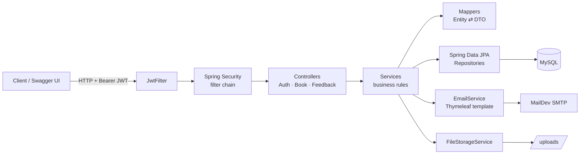
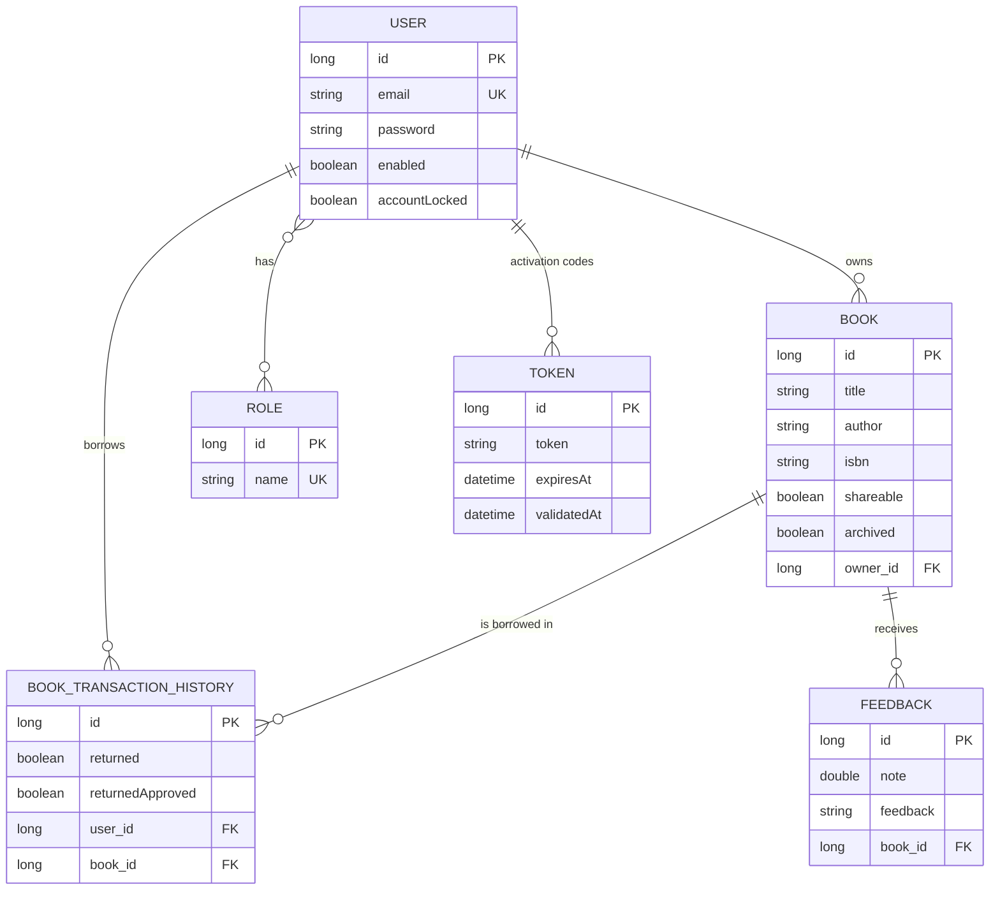
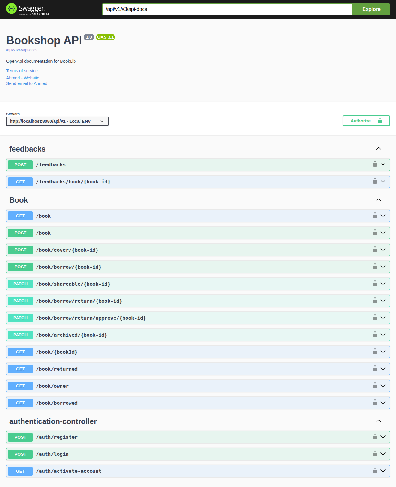
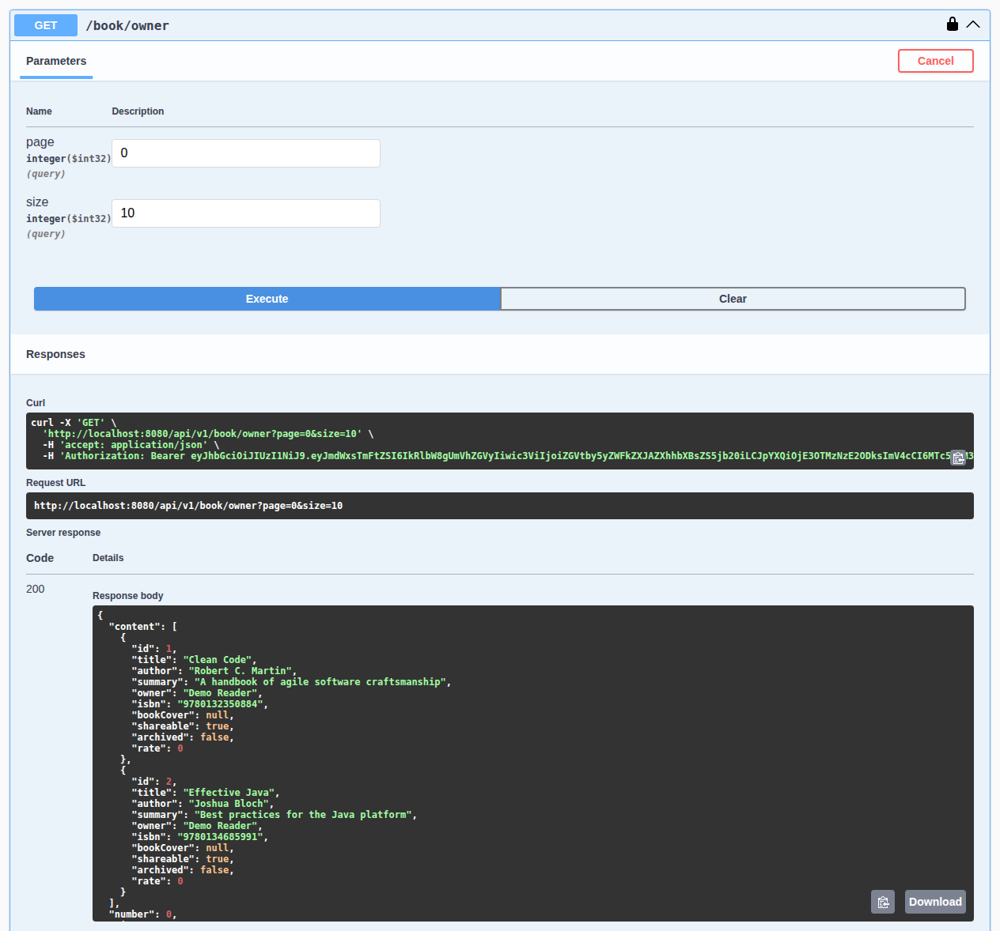

# 📚 BookLibrary — Book Sharing REST API

A **Spring Boot 3** backend where users register, publish their books, lend them to other members, approve returns and rate books, secured with **stateless JWT authentication**.

[](https://github.com/Ahmednaser30/BookLibrary/actions/workflows/ci.yml)


<!-- Optional, recommended for honesty: "Started from the Book Social Network course; I extended it with …" -->

---

## ✨ Features

**Authentication & accounts**
- Registration with Bean Validation and **BCrypt** password hashing
- **E-mail account activation**: 6-digit code (`SecureRandom`), 15-minute expiry, new code re-sent automatically when expired
- Login returns a signed **JWT** (jjwt 0.12, HMAC-SHA256) carrying the user's authorities and full name
- Stateless security filter chain (Spring Security 6), CORS restricted to the frontend origin

**Books**
- Create books, upload a cover image (multipart)
- Toggle **shareable** / **archived** status (owner only)
- Browse all shareable books of other users, or only your own (JPA **Specification**)
- Paginated, sorted responses with a generic `PageResponse<T>`

**Borrowing workflow**
- Borrow → return → **owner approves the return**
- Business rules: can't borrow your own book, archived or non-shareable books can't be borrowed
- Full borrowing history per user (`BookTransactionHistory`)

**Feedback**
- Rate (note) and comment on books you don't own; the average rating is computed per book

**Cross-cutting**
- **JPA auditing**: `createdBy`, `createdDate`, `lastModifiedBy`, `lastModifiedDate` filled from the security context
- **Global exception handling** with business error codes
- **OpenAPI 3 / Swagger UI** with a bearer-token security scheme

---

## 🏗️ Architecture



Layered packages: `controller` → `service` → `repository` → `entity`, with `dto`, `security`, `configuration` and `exception` alongside.

## 🗄️ Data model



---

## 🔌 API

Base path: `/api/v1` · Interactive docs: **http://localhost:8080/api/v1/swagger-ui.html**

| Method | Endpoint | Description | Auth |
|---|---|---|---|
| POST | `/auth/register` | Register a new account (sends activation e-mail) | — |
| GET | `/auth/activate-account?token=` | Activate account with the e-mailed code | — |
| POST | `/auth/login` | Authenticate, returns JWT | — |
| POST | `/book` | Create a book | JWT |
| GET | `/book/{bookId}` | Get one book | JWT |
| GET | `/book` | Shareable books from other users (paged) | JWT |
| GET | `/book/owner` | My books (paged) | JWT |
| GET | `/book/borrowed` | Books I borrowed (paged) | JWT |
| GET | `/book/returned` | Returns on my books (paged) | JWT |
| PATCH | `/book/shareable/{id}` | Toggle shareable (owner) | JWT |
| PATCH | `/book/archived/{id}` | Toggle archived (owner) | JWT |
| POST | `/book/cover/{id}` | Upload cover image (multipart) | JWT |
| POST | `/book/borrow/{id}` | Borrow a book | JWT |
| PATCH | `/book/borrow/return/{id}` | Return a borrowed book | JWT |
| PATCH | `/book/borrow/return/approve/{id}` | Approve a return (owner) | JWT |
| POST | `/feedbacks` | Rate and comment a book | JWT |
| GET | `/feedbacks/book/{id}` | Feedback for a book (paged) | JWT |

### Swagger UI

All endpoints, grouped by resource. Every endpoint outside `/auth` needs a JWT:



An authenticated call: after logging in and pasting the JWT into **Authorize**, `GET /book/owner` returns the caller's books as a paged response:



---

## ▶️ Run locally

**Prerequisites:** JDK 17+, Docker

```bash
git clone https://github.com/Ahmednaser30/BookLibrary.git
cd BookLibrary
docker compose up -d            # MySQL 8.4 + MailDev
cd bookShop && ./mvnw spring-boot:run
```

The defaults work out of the box for local development. To use your own passwords and a fixed JWT key,
copy `.env.example` to `.env` and edit it — both Docker Compose and the application read it.
`.env` is git-ignored; no credentials are stored in the repository.

| Service | URL |
|---|---|
| API | http://localhost:8080/api/v1 |
| Swagger UI | http://localhost:8080/api/v1/swagger-ui.html |
| MailDev (activation e-mails) | http://localhost:1080 |

## 🧪 Tests

```bash
cd bookShop && ./mvnw test
```

Tests run on an in-memory H2 database, so no MySQL or Docker is needed, and they run on every push via GitHub Actions.

| Test | Covers |
|---|---|
| `BookServiceTest` | Borrowing rules (own book, archived, already borrowed), owner-only updates, archive toggle |
| `BookTransactionHistoryRepositoryTest` | Custom JPQL queries and the "currently borrowed" check (`@DataJpaTest`) |
| `AuthenticationFlowIntegrationTest` | Register → activation e-mail → login refused until activated → one-time code → JWT login → create & list a book; 401 for missing or malformed tokens |

## 🔧 Engineering notes

Fixes and hardening done after the first version, each covered by a test where it applies:

- **Borrowing:** a book stays unavailable until its return is approved, so two users can't borrow it at once (the original query compared the history id with the user id)
- **Archiving** toggled the wrong flag
- **Registration** failed with HTTP 500 because the e-mail template was looked up by the enum constant instead of its file name
- **Authorization:** only a book's owner can replace its cover; uploads accept image types only
- **Error handling:** expired or malformed JWTs return 401 instead of 500, missing entities return 404, and internal error messages are no longer sent to the client
- **Configuration:** the JWT signing key, database and mail credentials come from environment variables / `.env`

---

## 🗺️ Roadmap

- [ ] Flyway migrations instead of `ddl-auto: update`
- [ ] Serve book covers by URL instead of embedding bytes in list responses
- [ ] Refresh tokens
- [ ] Angular frontend (`bookShop-ui`) to be published

## 👤 Author

**Ahmed Naser** · Java Backend Developer · [GitHub](https://github.com/Ahmednaser30)
